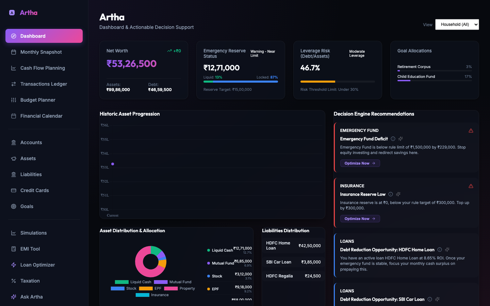
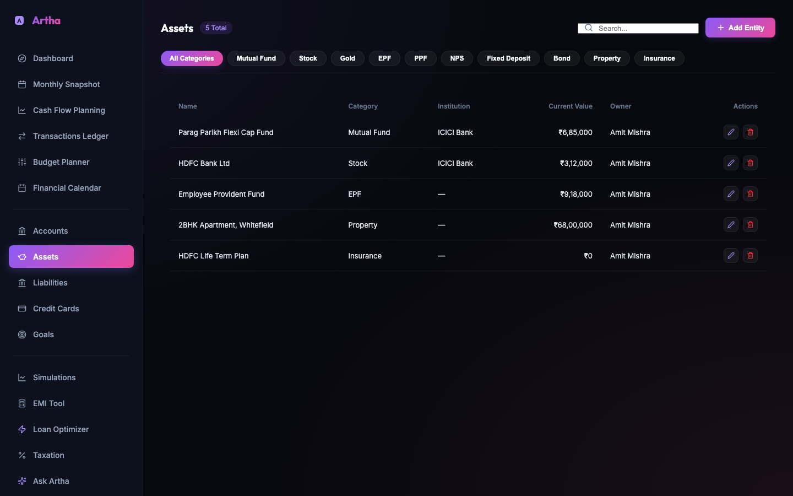
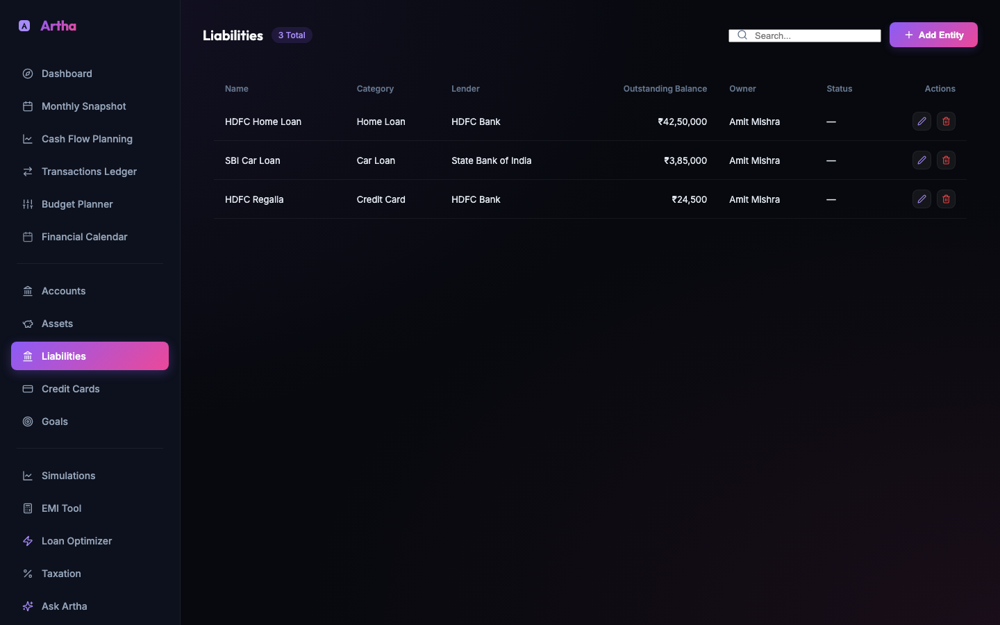
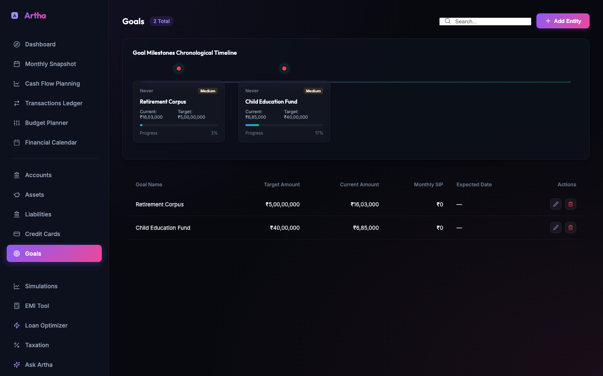
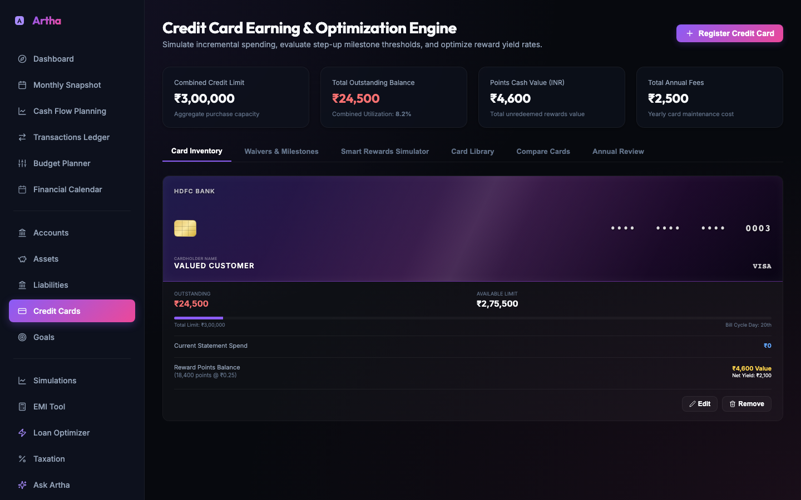
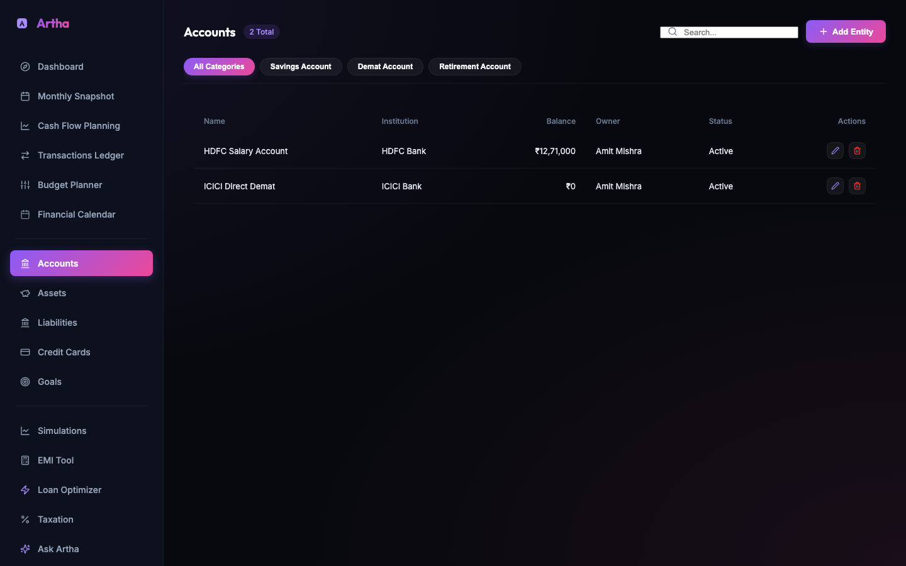

# Artha

**Artha** is a privacy-first, offline-first personal finance desktop app — a *Financial Intelligence Layer* on top of your raw account data, not another accounting tool. It runs entirely on your machine, needs no account, no cloud sync, and no installer, and helps you understand your net worth, debt strategy, investments, and tax position in one place.

MMex/your bank statements remain the system of record for day-to-day bookkeeping — Artha reads that data in and turns it into decision support: what to prepay, what to top up, what's underinsured, what your real tax liability looks like.

---

## Screenshots

**Dashboard** — net worth, emergency fund status, leverage risk, and live decision-engine recommendations


**Assets** — every holding across Mutual Funds, Stocks, EPF, Property, and Insurance in one grid


**Liabilities** — loans and credit cards with outstanding balances and lenders


**Goals** — target vs. current progress, derived live from linked holdings


**Credit Cards** — reward-yield simulation, milestone tracking, and card comparison


**Accounts** — balances derived live from a double-entry transaction ledger, never hand-edited


---

## Features

- **Net worth & decision engine** — assets, liabilities, and cash are aggregated into a live net worth figure, with color-coded recommendations for emergency fund shortfalls, insurance gaps, high-interest debt, and prepayment opportunities.
- **Double-entry accounts** — account balances are never stored or hand-edited; every balance is derived live from a transaction ledger (`transactions`), so it can't silently drift from reality.
- **Investments with per-holding lots** — Stocks and Mutual Funds track individual purchase lots (date, quantity, price), enabling accurate FIFO capital gains and per-holding XIRR, not just a single average cost.
- **Credit Cards reward-optimization engine** — category-based multipliers, milestone step-ups, mileage-transfer redemptions, lounge tracking, a Card Library, side-by-side Compare Cards, and an Annual Review (keep/close/upgrade/downgrade recommendations).
- **Properties with a rental ledger** — month-by-month rent and expense entries, not a single flat field.
- **Insurance with claims & premium history** — per-policy claim and payment logs, alongside Life/Term/Health/Vehicle sub-typing.
- **Taxation** — Old vs. New regime comparison, deductions, capital gains estimate, per financial year and per person.
- **Loan tools** — EMI calculator, an interactive prepayment/tenure simulator with mid-month lump-sum scheduling and pro-rata daily interest, and a cross-loan prepayment optimizer.
- **Goals** — target amounts with completion dates derived from linked asset allocations, not a manually-typed progress number.
- **Financial Calendar, Budget Planner, Cash Flow Planning** — recurring dues, category budgets, and monthly cash flow projections.
- **Knowledge Base** — seeded, read-only concept explainers surfaced contextually where they're relevant.
- **AI Assistant ("Ask Artha")** — opt-in explain/compare/summarize over your already-computed data. Off by default; AI never modifies schema, calculations, or business rules.
- **Configurable branding** — pick from 3 logo marks and 5 accent color presets in Settings.
- **Documents** — attach files (statements, policy PDFs) to any financial entity.
- **MMex import** — sync account balances from Money Manager Ex exports.
- **Dynamic database switcher** — open or create SQLite portfolios anywhere on disk via native OS dialogs, hot-switch at runtime.
- **15-minute monthly maintenance** — logging a month's snapshot is designed to take under 15 minutes.

---

## Get the App

Artha ships three ways. Pick whichever fits how you want to run it.

### 1. Portable desktop app (recommended for most people)

No installation, no admin rights. The database lives next to the app itself, so the whole thing — app and data — can run off a USB drive.

| Platform | Format | Notes |
| --- | --- | --- |
| Windows | Portable `.exe` | Double-click to launch |
| macOS | `.dmg` / `.zip` (Intel + Apple Silicon) | **Unsigned** — see note below |
| Linux | `.AppImage` | `chmod +x` then run |

Grab the latest build from the **[Releases](../../releases)** page.

> **macOS note:** builds are intentionally unsigned (no Apple Developer ID in this repo). Gatekeeper will warn "unidentified developer" — right-click → **Open** the first time, or run `xattr -cr Artha.app` if it still refuses.

### 2. Run from source

```bash
git clone https://github.com/my-private-repo/Artha.git
cd Artha

python -m venv venv
source venv/bin/activate        # Windows: venv\Scripts\activate
pip install -r backend/requirements.txt
pip install pyinstaller
npm install

npm start                       # Windows: Vite + FastAPI + Electron, all at once
# macOS: ./start.sh (see start.sh/stop.sh — dev convenience only, not packaging)
```

Requires [Node.js](https://nodejs.org/) v20+ and [Python](https://www.python.org/) v3.12+.

### 3. Docker / web deployment

For running Artha on a home server or shared machine instead of as a desktop app:

```bash
docker compose up --build
```

Frontend on `http://localhost:8080`, backend on `http://localhost:8000` by default (both overridable — see `docker-compose.yml`). This mode is opt-in hardened with a CORS allowlist and shared-secret API auth (`ARTHA_API_SECRET`) for anything beyond a trusted local network — see [Security Architecture](Architecture/11-Security-Architecture.md).

---

## Building It Yourself

```bash
npm run package:portable   # Windows -> dist-portable/Artha <version>.exe
npm run package:mac        # macOS   -> dist-portable-mac/Artha-<version>{.dmg,.zip}
npm run package:linux      # Linux   -> dist-portable-linux/Artha-<version>.AppImage
```

Each script chains a frontend build + a platform-appropriate PyInstaller backend build, then electron-builder. PyInstaller doesn't cross-compile — build on the OS you're targeting.

---

## CI/CD

Two independent GitHub Actions pipelines:

- **`build-and-publish.yml`** — builds the Windows/macOS/Linux desktop app on every push to `main` and PRs; publishes all three installers as a GitHub Release when a `v*` tag is pushed.
- **`docker-build.yml`** — builds and pushes the `backend`/`frontend` Docker images to GHCR (`ghcr.io/<owner>/artha-backend`, `artha-frontend`) on push to `main` and `v*` tags.

---

## Documentation

- **[Artha.md](Artha.md)** — the master product vision and specification.
- **[Architecture/](Architecture/)** — the authoritative architecture doc set: full schema inventory, per-domain data model/API/business-rule breakdowns, known bugs, and what's shipped vs. roadmap. Start with [00-Project-Constitution.md](Architecture/00-Project-Constitution.md); [15-Roadmap.md](Architecture/15-Roadmap.md) and [16-Session-Log.md](Architecture/16-Session-Log.md) track status and decision history.
- **[hardcoded_vs_dynamic.md](hardcoded_vs_dynamic.md)** — which business-rule thresholds are DB-configurable vs. hardcoded.
- **[CLAUDE.md](CLAUDE.md)** — architecture quick-reference for contributors (and for AI coding assistants working in this repo).

---

## License

Personal project — no license file present; all rights reserved unless stated otherwise.
