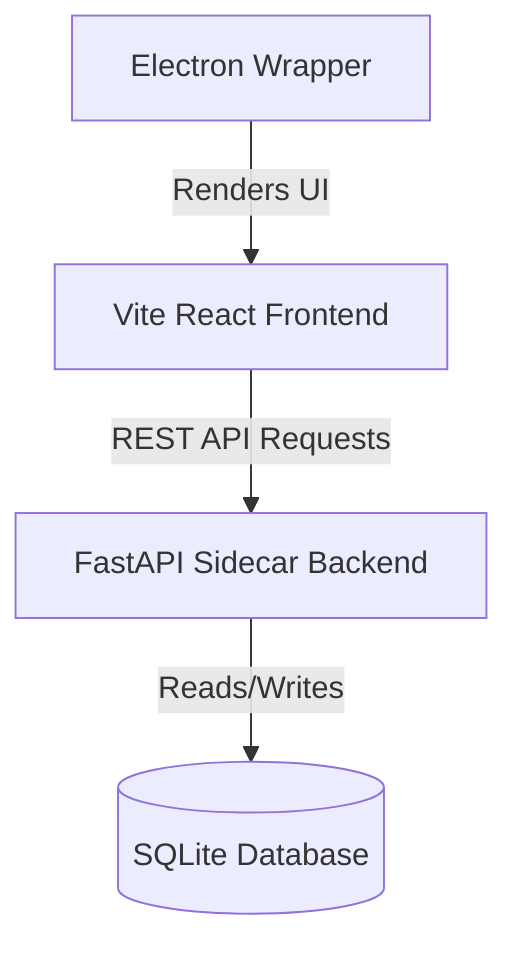

# 01-Architecture - Financial Operating System (FOS)

## Purpose
This document specifies the system architecture, component modules, layered design, folder structures, and coding standards of FOS / Artha.

## Scope
Covers the multi-tier desktop application architecture, backend sidecar server, frontend layout, data flows, and design principles.

## Definitions
*   **Electron Wrapper:** The desktop container hosting the web interface and managing child processes.
*   **FastAPI Sidecar:** Python backend running locally to serve data and perform finance calculations.
*   **React Frontend:** TypeScript Vite application presenting the user interface.

## Design Decisions
1.  **Vite + React with TypeScript:** Selected for fast hot module replacement and static analysis/typing safety.
2.  **FastAPI with Uvicorn:** Selected for speed, automatic openAPI documentation generation, and high-performance serialization.
3.  **Local SQLite Database:** Used to guarantee zero latency and local-first data storage.
4.  **Sidecar Process Management:** Electron spawns the FastAPI server on launch and terminates it on exit.

## System Design and Flow Diagram


## Folder Structure
```
artha/
├── backend/            # Python FastAPI backend server
├── src/                # Vite React TypeScript frontend source
├── electron/           # Electron main process files
└── docs/               # Modular software specification suite
```

## Examples
*   *Application Initialization:*
    1.  Electron launches, finds an open port (default: 8000), and spawns `python backend/main.py`.
    2.  React frontend mounts and calls `/api/init` to check backend readiness and fetch database records.

## Future Enhancements
*   Modular plugin system to easily write custom parsers for PDF bank statements.
*   WebSockets implementation for real-time calculation progress during massive data imports.

## Open Questions
*   Should we pack the Python executable into a single binary using PyInstaller for distributed releases, or continue relying on a local python virtual environment?
