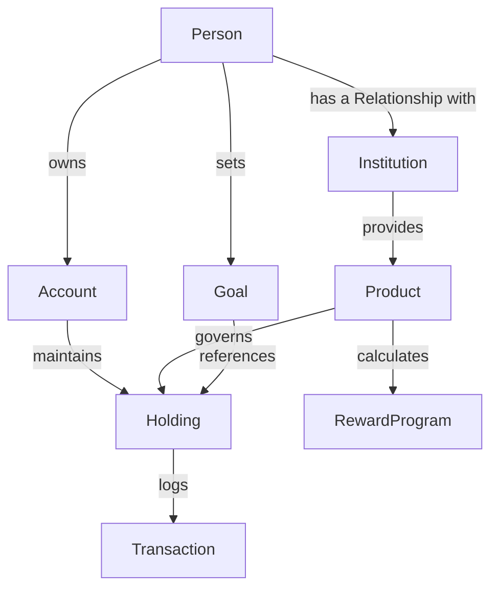

# 02-Relationship-Model - Relationship Model

## Purpose
This document specifies how every business object in the Financial Operating System is connected, defining strict ownership, references, constraints, and disallowed links.

## Scope
Covers the logical connection rules between business objects prior to domain mapping.

## Definitions
*   **Logical Ownership:** The hierarchy determining which object manages the lifecycle of another (e.g. an Account contains Transactions).
*   **Reference Relationship:** A loose link where an object points to another without owning it (e.g. a Goal references Holdings).

## Responsibilities
*   To prevent circular references and validate data mapping boundaries.
*   To ensure strict separation of concerns (e.g. Person can never link directly to Transactions).

---

## Object Relationship Diagram

---

## Connection Rules

### 1. Person
*   **Can own:** Accounts, Goals, Portfolios.
*   **Can reference:** Institutions.
*   **Can link to:** Relationships.
*   **Can never link to:** Individual Transactions directly.

### 2. Institution
*   **Can own:** Products.
*   **Can link to:** Relationships.
*   **Can reference:** Accounts (which are maintained inside the institution).
*   **Can never link to:** Goals.

### 3. Relationship
*   **Can link to:** Person, Institution.
*   **Can reference:** Customer IDs.
*   **Can never link to:** Transaction ledger lines.

### 4. Account
*   **Can own:** Holdings.
*   **Can contain:** Transactions.
*   **Can link to:** Institution.
*   **Can reference:** Portfolios.
*   **Can never link to:** Goals directly (ownership goes through Holdings).

### 5. Financial Product
*   **Can generate:** Interest rates, rewards points templates.
*   **Can link to:** Institution.
*   **Can reference:** Category rules.
*   **Can never link to:** Account balances directly.

### 6. Holding
*   **Can belong to:** Portfolio, Goals, Net Worth indexes.
*   **Can link to:** Product, Account.
*   **Can never link to:** Customer IDs.

### 7. Transaction
*   **Can belong to:** Account.
*   **Can reference:** Categories.
*   **Can link to:** Holding.
*   **Can never link to:** Institution details directly.

### 8. Goal
*   **Can reference:** Multiple Holdings.
*   **Can link to:** Person.
*   **Can never directly own:** Accounts.

### 9. Reward Program
*   **Can link to:** Card Products, Transactions.
*   **Can never directly own:** Cash currencies.

---

## Examples
*   *Mutual Fund Purchase:* A Person executes an investment Transaction. The Transaction logs under a Savings Account, creating/updating a Mutual Fund Holding governed by a specific Product provided by a Brokerage Institution.

## Business Rules (Conceptual)
*   **Unidirectional Ledger Updates:** Transactions can only be generated inside an Account container, and must instantly update the linked Holding value.

## Future Enhancements
*   Implementing family-joint ownership mapping layers where multiple Persons share an Account.

## Open Questions
*   Should a Transaction be allowed to reference multiple categories, or be strictly restricted to one category?

## References
*   *Enterprise Software Design Standards*
*   *Data Integration Patterns*
