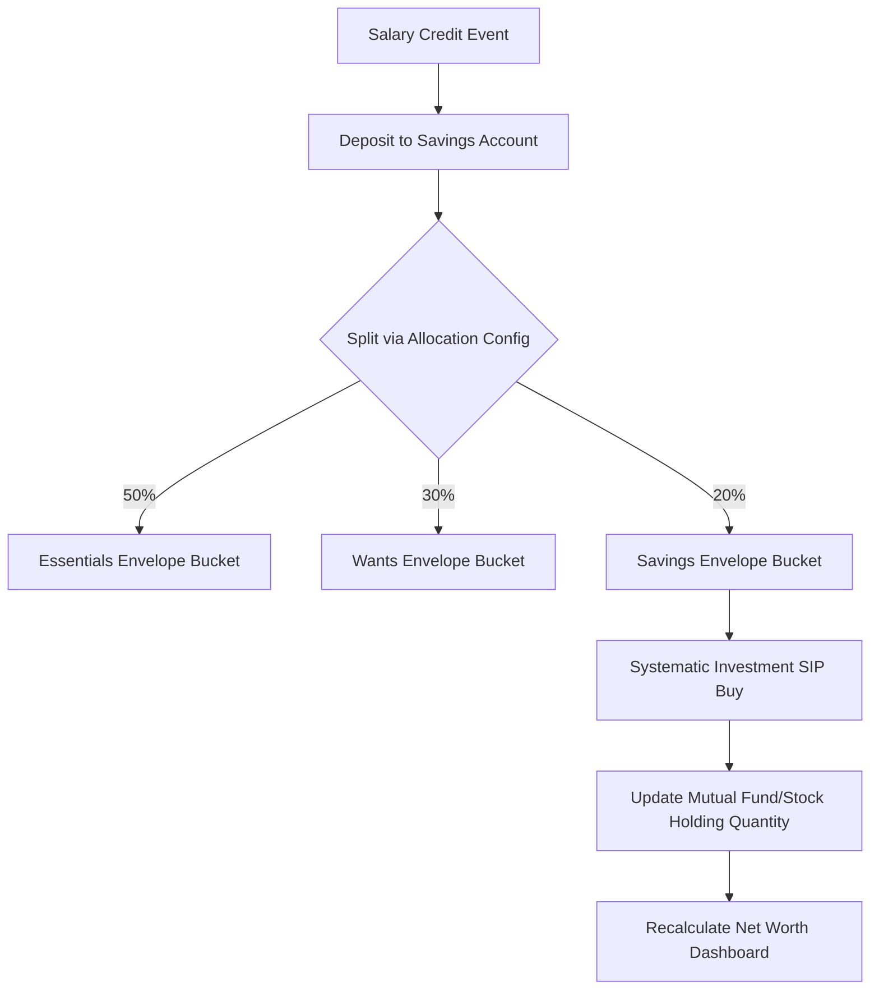
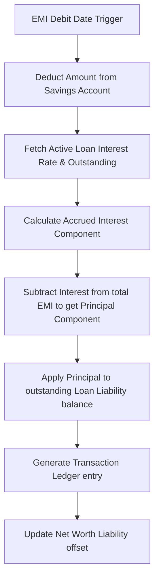
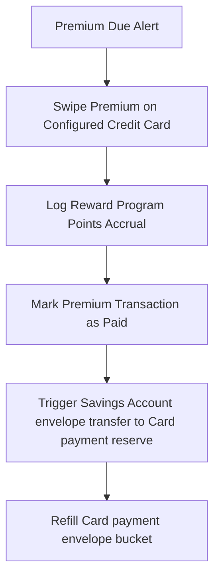

# 08-Workflows - Workflow Design

## Purpose
This document specifies the operational execution workflows and sequence transitions in the Financial Operating System (FOS) / Artha. It details the steps, triggers, and state changes for capital movements and debt amortization.

## Scope
Covers the core transactional and calculation workflows (Salary Allocation, Loan Repayments, and Insurance Payments).

## Definitions
*   **Sequential Transition:** The step-by-step progression of data and actions through components.
*   **Balance Sweep:** Automatically transferring excess cash from one bucket to an investment holding.

## Responsibilities
*   Define the exact order of transactional execution.
*   Prevent balance or calculation desynchronization during data sweeps.

## Relationships
*   Specifies how Transactions interact with Accounts, Holdings, and Goals during active operations.

---

## Core Operational Workflows

### 1. Salary Credit & Allocation Workflow
*   **Triggers:** Monthly salary transaction logs into a Savings Account.
*   **Flowchart:**

### 2. Loan EMI Repayment Workflow
*   **Triggers:** Monthly scheduled EMI debit date.
*   **Flowchart:**

### 3. Insurance Premium Payment & Reserve Refill Workflow
*   **Triggers:** Insurance policy premium due alert.
*   **Flowchart:**

---

## Examples
*   *Salary Allocation Sweep:* Logging a salary credit of ₹1,00,000 immediately locks ₹50,000 for essentials, splits ₹20,000 into investment transactions, and flags the remaining ₹30,000 as discretionary wants balance.

## Business Rules (Operational)
*   **Atomic Transactions:** All steps within a workflow must succeed or roll back together. For example, if a loan payment transaction fails, the savings account balance must not be decremented.

## Future Enhancements
*   Adding automated cash sweeping rules to move cash from checking to high-yield savings when savings exceed a set target.

## Open Questions
*   How should the system behave if the savings account balance is insufficient to cover a scheduled EMI repayment workflow?

## References
*   *Financial Ledger Execution Flows*
*   *Enterprise ERP Workflow Standards*
